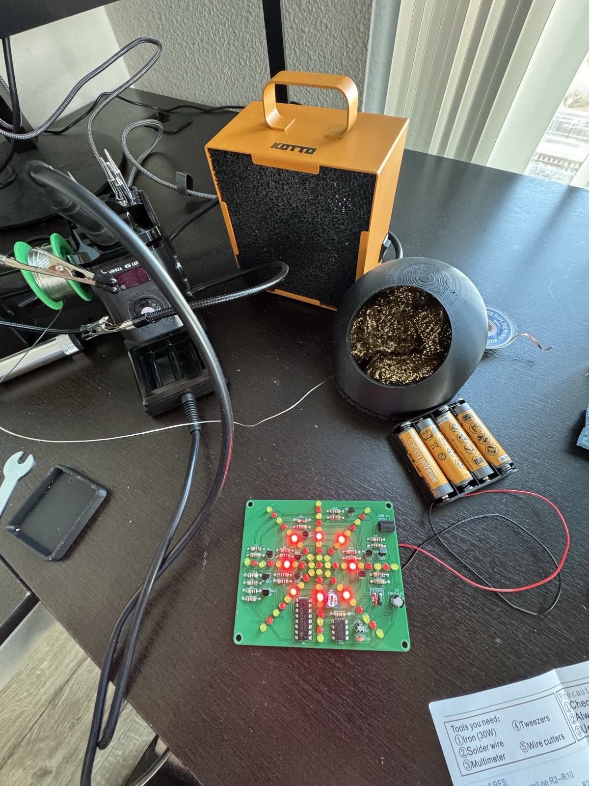
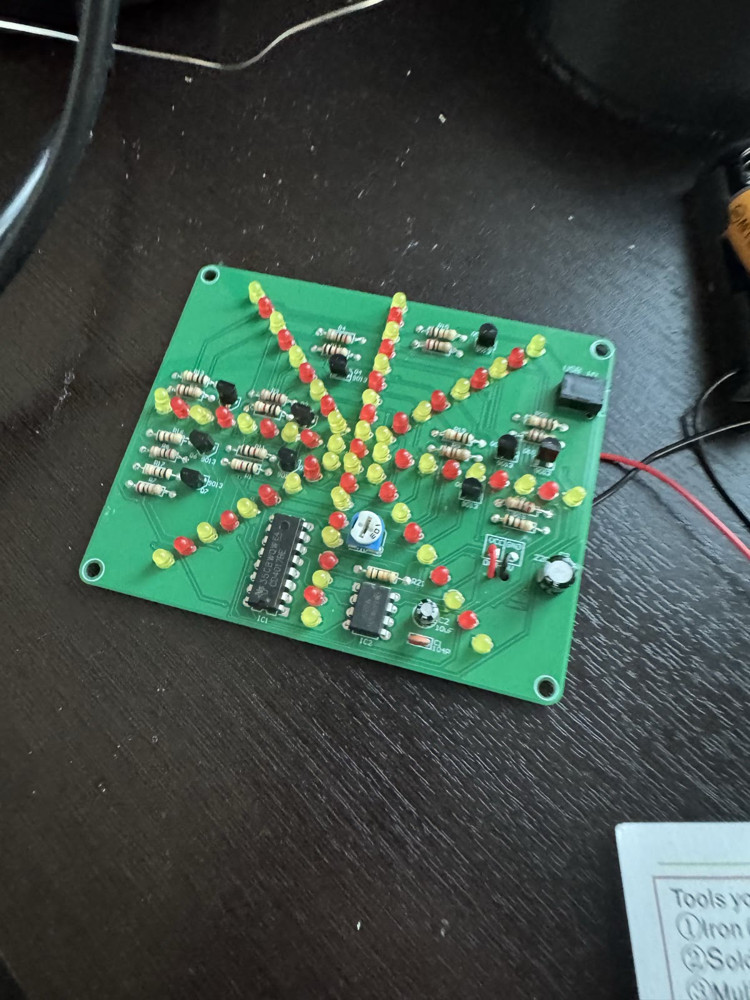
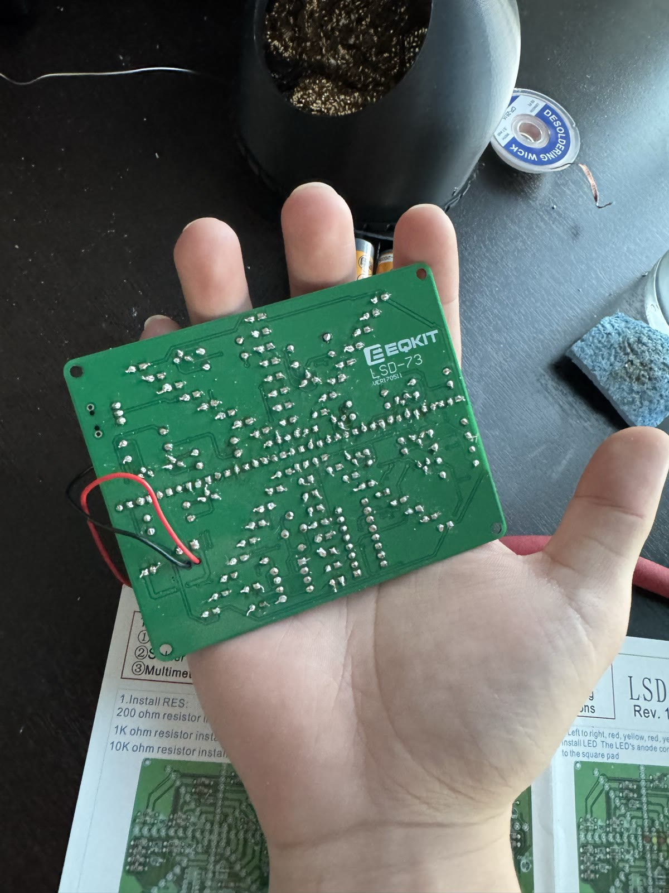
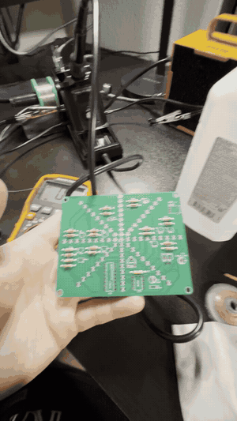

# LED Soldering Kit: EQKIT LSD-73

My first through-hole soldering project. It's a board of red and yellow LEDs that light up in a chasing, spinning pattern. I built it from a kit between late October and early November 2026, and fixed my mistakes along the way.



| Finished front | Solder joints on the back |
|---|---|
|  |  |

**Early in the build:** only the resistors were in.



## How the circuit works

```
NE555 timer  ->  CD4017 counter  ->  9013 transistors  ->  LED rays
(makes the       (turns on its 10     (each switches      (light up one
 clock pulses)    outputs one by one)  a group of LEDs)    group at a time)
```

- The **NE555** (IC2) is set up as an oscillator and sends out a steady stream of pulses.
- The **potentiometer** changes how fast those pulses come, so it sets the speed of the pattern.
- The **CD4017** (IC1) is a decade counter. Each pulse moves it to the next of its 10 outputs.
- Each output drives a **9013 transistor**, which switches on a group of LEDs. The chip can't supply enough current for a whole group of LEDs, so the transistors do the switching.
- Power comes from a 4×AA battery pack or USB 5V.

## Parts

| Part | On the board | What it does |
|---|---|---|
| NE555 timer IC | IC2 | Makes the clock pulses |
| CD4017 decade counter IC | IC1 | Steps through 10 outputs, one per pulse |
| 9013 NPN transistors | Q1–Q10 | Switch the LED groups on and off |
| Resistors (200Ω, 1kΩ, 10kΩ) | R1–R21 | Limit current to the LEDs and set transistor and timer values |
| Potentiometer | VR1 | Adjusts the speed |
| 0.1µF ceramic capacitor (104) | C1 | Filters noise |
| 10µF electrolytic capacitor | C2 | Works with the 555 to set the timing |
| 220µF/16V electrolytic capacitor | C3 | Smooths the power supply |
| Red and yellow LEDs | — | The light pattern |
| 4×AA battery pack or USB | DC 4–5V | Power |

## What went wrong and how I fixed it

### 1. Oxidized soldering tip
The tip kept oxidizing and solder stopped flowing onto it. I made two mistakes:
- **I didn't tin the tip after each use.** Leaving a fresh layer of solder on the tip before putting the iron back in the stand protects it from oxidizing.
- **I used a wet sponge instead of brass wool.** The sponge cools the tip and doesn't clean as well. I switched to brass wool (you can see it in the bench photo), and the tip stayed clean.

### 2. Overbent LED legs
I bent some LED legs too far when fitting them into the board. That caused problems that took a lot of troubleshooting to track down. I had to find the bad LEDs, desolder them, and fix them.

### 3. A faulty multimeter
When I used my multimeter to diagnose the problem, its readings didn't make sense, so it was hard to tell what was wrong with the board. It turned out the meter itself was faulty. Once I replaced it, the readings made sense and I could find the real problem.

## What I learned

- **Soldering:** heating the pad and the leg together, then feeding in solder for a clean joint.
- **Desoldering:** removing solder with desoldering wick to pull out and redo parts.
- **Troubleshooting:** working through a board step by step to find what's actually wrong, and not trusting a tool just because it's a tool.
- **Reading a schematic:** matching the symbols and labels (IC1, Q1, R1…) to the real parts on the board.
- **Components:** what each part does: timer, counter, transistors, resistors, capacitors and LEDs.

## Tools I used

- Temperature-controlled soldering station and solder wire
- Brass wool tip cleaner
- Desoldering wick
- Helping hands with alligator clips
- Fume extractor
- Digital multimeter
